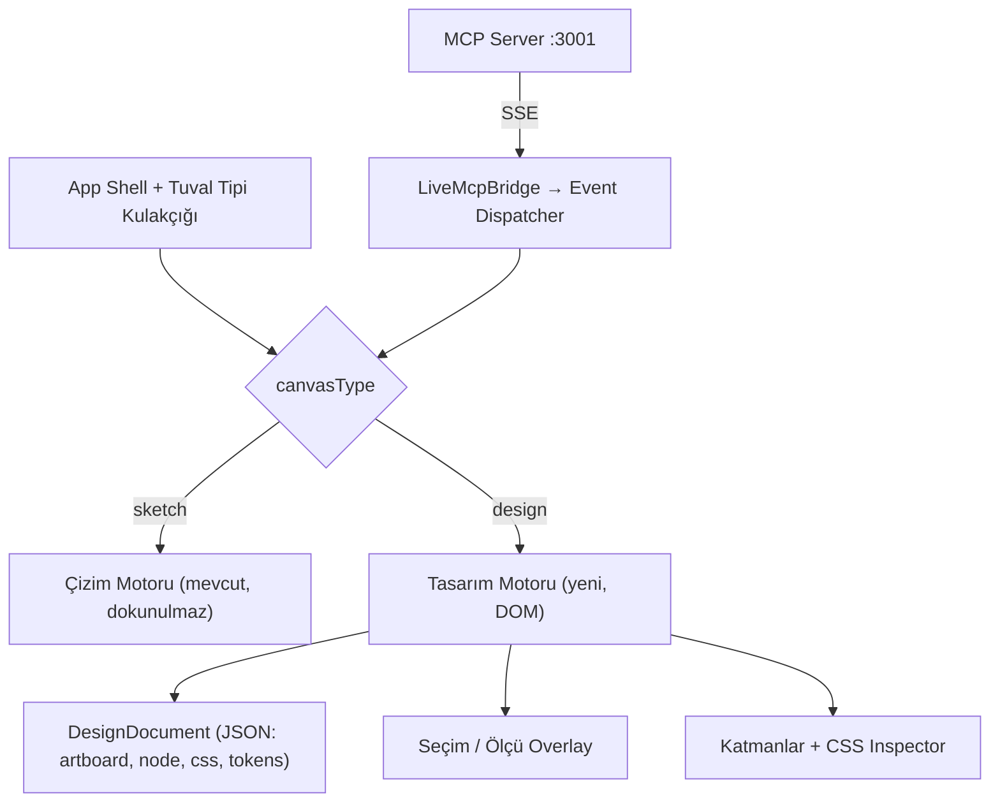

# Fizibilite: CSS Odaklı, Pixel-Perfect "Tasarım Tuvali"

## 1. Talep Özeti
- Mevcut Çizim Tuvali ve eklediğimiz tüm özellikler **olduğu gibi** kalacak.
- Ekranın en tepesinde bir **kulakçık (tab)** ile tuval tipi seçilecek:
  - **Çizim Tuvali** (mevcut el çizimi / diyagram tuvali)
  - **Tasarım Tuvali** (yeni, CSS odaklı, Figma'ya yakın, pixel-perfect)
- Seçim yapıldıktan sonra **değiştirilemeyecek**.
- Yapay zeka MCP üzerinden tasarımı pixel-perfect aktarabilecek.

**Sonuç: Yapılabilir.** Ancak "pixel-perfect" hedefi, mevcut 2B el çizimi motoruyla
**karşılanamaz**. Yeni bir render motoru (DOM tabanlı) gerekiyor. Mevcut mimariyi tamamen
bırakmak gerekmiyor; uygulama kabuğu, MCP köprüsü ve container fikri yeniden kullanılabilir.

---

## 2. Mevcut Durum Analizi

| Bileşen | Mevcut hali | Tasarım tuvali için anlamı |
|---|---|---|
| Render | Canvas 2D + Rough.js, kendi metin ölçümü | CSS (flex, grid, shadow, gradient, web font) birebir çizilemez |
| HTML aktarımı | Gizli sandbox'ta render edip `getBoundingClientRect` ile şekle çeviriyor | Ölçüm doğru, ama sonuç dikdörtgen + metne indirgeniyor → stil kaybı ve metin kayması |
| MCP sunucusu | `synapdraw-mcp/src/server.ts`: `read_me`, `render_mermaid`, `render_html`, `get_canvas_context`, `clear_canvas`, `create_view`, checkpoint araçları | Broadcast (SSE) + context sync altyapısı aynen yeniden kullanılabilir |
| Köprü | `LiveMcpBridge.tsx` SSE ile olayları alıp çizim API'sine uyguluyor | Olay tipine göre aktif motora yönlendiren bir dispatcher'a dönüşmeli |
| Container / kilit | Frame + card + header, iki modlu kilit | Tasarım tuvalinde karşılığı **Artboard** (Figma frame) |
| Gömülü içerik | `iframe` / `embeddable` eleman tipleri var | Hibrit yaklaşım için kaldıraç (bkz. Seçenek B) |

> [!IMPORTANT]
> Metin kayması sorununun kök nedeni de burada: Çizim tuvali metni kendi motoruyla ölçüp sarıyor,
> tarayıcı CSS ile farklı sarıyor. Bu fark optimizasyonla küçülür ama sıfırlanamaz.

---

## 3. Değerlendirilen Yaklaşımlar

### Seçenek A: Çizim Tuvali üzerinde "hassas stil" preset
roughness 0, keskin köşe, Inter fontu, grid snapping.
- ✅ Çok ucuz (1-2 gün)
- ❌ Pixel-perfect **değil**: flex/grid, gölge, gradient, border-radius detayları, font render farkı
- **Sonuç: Talebi karşılamıyor.**

### Seçenek B: Hibrit (Çizim Tuvali + iframe artboard)
Her artboard bir `iframe` elemanı; içinde gerçek HTML/CSS render edilir.
- ✅ Artboard içi gerçekten pixel-perfect
- ✅ Pan/zoom, collab, persistence hazır
- ❌ Artboard içindeki elemanlar tuvalde tek tek seçilip düzenlenemez (iframe sınırı)
- ❌ Zoom'da iframe ölçekleme ve pointer olayı çakışmaları
- **Sonuç: "Önizleme" için iyi, Figma tarzı düzenleme için yetersiz.**

### Seçenek C (Önerilen): DOM tabanlı Tasarım Motoru
Tuval, CSS `transform: scale/translate` ile pan/zoom yapılan bir viewport'tur.
Artboard'lar gerçek DOM düğümleri olarak (Shadow DOM içinde, stil izolasyonlu) render edilir.
Seçim, hover, ölçü çizgileri ayrı bir overlay katmanında çizilir.
- ✅ Tarayıcı render ettiği için **tanım gereği pixel-perfect**
- ✅ Her düğüm seçilebilir, CSS özellikleri inspector'dan düzenlenebilir
- ✅ AI çıktısı (HTML+CSS) dönüşümsüz, kayıpsız aktarılır
- ✅ Export doğrudan HTML/CSS koddur
- ❌ En yüksek efor; seçim/sürükleme/undo/persistence yeniden yazılır

---

## 4. Önerilen Mimari



### 4.1 Soyutlama katmanı
- `CanvasEngine` arayüzü: `applyEvent()`, `getContext()`, `clear()`, `exportData()`.
- `SketchEngine`: mevcut çizim API çağrılarını sarar (**davranış değişmez**).
- `DesignEngine`: yeni motor.
- MCP köprüsü olay tipine göre aktif motora yönlendirir; motorun desteklemediği olay
  (ör. tasarım tuvalinde `mermaid`) anlamlı bir hata ile reddedilir.

### 4.2 Tuval tipi seçimi ve kilitlenmesi
- Kulakçık yalnızca **boş/yeni belgede** aktif.
- İlk içerik eklendiği an (veya kullanıcı onayıyla) `canvasType` belgeye yazılır ve kulakçık
  salt-okunur hale gelir (seçili tip görünür, diğeri pasif + açıklama tooltip'i).
- Değer belge verisinde saklanır (localStorage + export dosyası), böylece yeniden yüklemede korunur.

### 4.3 Sonsuz Tuval & İçerik Odaklı Tasarım Modeli (Figma Yaklaşımı)
Figma'da tuvalin kendisi **tamamen sınırsız ve sonsuzdur (Infinite Canvas)**. Kullanıcı veya AI asla sabit bir tuval boyutuna zorlanmaz.
Tasarım elemanları tuval üzerinde şu prensiplerle yer alır:
- **Sonsuz 2D Düzlem**: Koordinatlar `(-∞, +∞)` arasında uzanır. Arka plan sonsuz nokta ızgarasıdır.
- **İçeriğe Göre Otomatik Boyutlanma (Figma "Hug Contents")**: Aktarılan HTML/CSS bileşenleri sabit pencerelere zorlanmaz. İçeriğin doğal CSS boyutu ne ise (`width: auto / fit-content`, `height: auto`), container doğrudan onu sarar ve tuvale yerleşir.
- **İsteğe Bağlı Cihaz/Genişlik Çerçevesi**: Yalnızca kullanıcı özellikle bir genişlik istediğinde (ör. mobil için 390px veya responsive test için) sınır konur; aksi takdirde tasarım serbest ve doğal akışında render edilir.

```ts
type DesignItem = {
  id: string;
  name: string;
  x: number;
  y: number;
  width?: number | "auto";   // "auto" (Hug Contents) veya özel genişlik
  height?: number | "auto";  // "auto" (Hug Contents)
  html: string;
  css?: string;
  locked: boolean;           // Tam kilit
  allowMove: boolean;        // Yalnızca taşıma serbest
};

type DesignDocument = {
  canvasType: "design";
  items: DesignItem[];
  zoom: number;
  panX: number;
  panY: number;
};
```
Mevcut **iki modlu kilit** (tam kilit / sadece taşıma) bu bileşenlere de aynen uygulanır.

---

## 5. Yeni MCP Araçları (Figma Mantığı)

| Araç | Amaç |
|---|---|
| `get_canvas_type` | Aktif tuval tipini döner; AI doğru aracı seçer |
| `render_design` | HTML + CSS'i sonsuz tuvale **doğal boyutunda (Hug Contents)** veya istenen konumda yerleştirir |
| `create_frame` | İsteğe bağlı olarak belirli bir genişlikte veya serbest çerçeve açar |
| `get_design_tree` | Düğüm ağacı + computed style + gerçek piksel sınırları |
| `update_node_styles` | Düğüm id'sine göre CSS özelliklerini günceller |
| `screenshot_design` | Tasarımın veya tüm görünümün PNG görüntüsü |
| `compare_with_reference` | Referans görsel ile piksel farkı (diff yüzdesi + fark haritası) |
| `export_design_code` | Tasarımı temiz HTML/CSS olarak dışa aktarır |

> [!TIP]
> Pixel-perfect'in gerçek anahtarı `screenshot_artboard` + `compare_with_reference` döngüsü:
> AI render eder → ekran görüntüsünü alır → referansla kıyaslar → `update_node_styles` ile düzeltir.

---

## 6. Riskler

| Risk | Etki | Önlem |
|---|---|---|
| AI'dan gelen HTML'de script / XSS | Yüksek | DOMPurify ile sanitize, `script`/`on*` yasak, Shadow DOM izolasyonu |
| Stil sızıntısı (uygulama CSS'i ↔ tasarım CSS'i) | Orta | Her artboard Shadow DOM içinde |
| Web font yüklenmeden render / ekran görüntüsü | Orta | `document.fonts.ready` beklenir, font listesi belgeye kaydedilir |
| Zoom'da bulanıklık | Düşük | CSS transform zaten vektörel; ekran görüntüsü 1x/2x ayrı alınır |
| Collab yalnızca çizim şemasını biliyor | Orta | MVP'de tasarım tuvalinde collab kapalı; sonraki faz |
| Undo/redo, çoklu seçim, snapping sıfırdan | Yüksek efor | MVP'de sınırlı kapsam (seç, taşı, CSS düzenle, undo) |
| Çekirdek güncellemeleriyle çakışma | Düşük | Yeni motor ayrı paket/klasör; çekirdek motora dokunulmaz |

---

## 7. Fazlar ve Kaba Efor

| Faz | Kapsam | Tahmini |
|---|---|---|
| 0 | Önceki işteki regresyonu düzelt (bkz. §8) | 0.5 gün |
| 1 | `CanvasEngine` soyutlaması, kulakçık, tip kilidi, köprü dispatcher | 2-3 gün |
| 2 | Tasarım motoru MVP: viewport pan/zoom, artboard, Shadow DOM render, seçim overlay, persistence | 5-7 gün |
| 3 | MCP: `render_design`, `create_artboard`, `get_design_tree`, `update_node_styles`, `get_canvas_type` | 2-3 gün |
| 4 | Katmanlar paneli + CSS inspector, artboard kilit modları | 3-4 gün |
| 5 | `screenshot_artboard`, `compare_with_reference`, `export_design_code`, tokens | 3-4 gün |

**Toplam: ~3-4 hafta** (tek geliştirici, MVP+). Faz 1-3 sonunda uçtan uca demo mümkün.

---

## 8. Not: Önceki Commit'te Düzeltilmesi Gereken Regresyon

> [!WARNING]
> `50c3f642` commit'indeki `isContainerElement`, `isFrameLikeElement` olan **her frame'i** ve
> frame içindeki **her elemanı** container sayıyor. Sonuç: kullanıcının çizim tuvalinde elle
> oluşturduğu normal frame'ler ve içlerindeki şekiller de artık yeniden boyutlandırılamıyor.
> Bu, "mevcut özellikleri bozmadan" ilkesine aykırı. Kontrol yalnızca
> `customData.isContainerFrame/Card/Header` ile sınırlanmalı.

---

## 9. Karar Bekleyen Sorular
1. **Tip kilidi kapsamı:** Belge başına mı (yeni belge açınca yeniden seçilebilir) yoksa
   uygulama genelinde kalıcı mı?
2. **MVP kapsamı:** Tasarım tuvalinde kullanıcı da sıfırdan çizebilecek mi (dikdörtgen/metin
   aracı), yoksa ilk aşamada AI ile üretilen tasarımı **seç, taşı, CSS düzenle** yeterli mi?
3. **Mevcut özellikler tasarım tuvalinde:** Mermaid / el çizimi araçları orada da olsun mu,
   yoksa tamamen ayrık iki deneyim mi?
4. **Yaklaşım onayı:** Seçenek C (DOM tabanlı motor) ile ilerleyelim mi?
