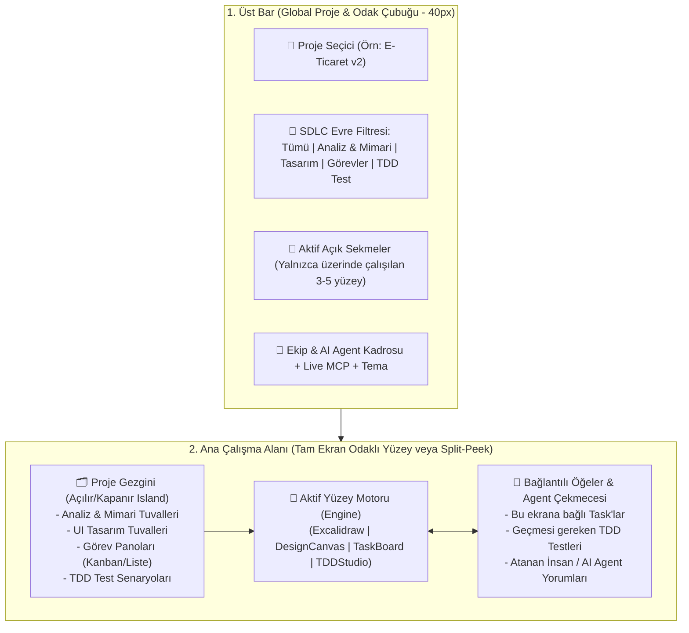

# SynapDraw SDLC Super-App: UI/UX ve Mimari Yol Haritası

Bu plan; **SynapDraw**'ı yalnızca çizim ve ekran tasarımı yapılan bir araçtan, bir yazılımın **Analiz → Mimari → UI/UX Tasarım → Görev Yönetimi → TDD Test Senaryoları** yaşam döngüsünün tamamını **kaos yaratmadan**, Excalidraw'ın yalın tasarım dilini koruyarak tek çatı altında toplayan bir **SDLC Super-App** mimarisine taşımak için hazırlanmıştır.

> [!IMPORTANT]
> **Temel UI/UX İlkesi — "Sıfır Kaos, Bağlamsal Odak (Contextual Focus)":**
> Kullanıcı aynı anda 5 farklı aracı ekranda sıkışmış halde görmemelidir. Her çalışma yüzeyi (Çizim, Tasarım, Görev Panosu, TDD Test Stüdyosu) kendi tam ekran tuvalinde nefes almalı; ancak **Proje Gezgini (Sol Çekmece)** ve **Bağlam Çekmecesi (Sağ İlişkili Öğeler Paneli)** sayesinde analizden tasarıma, tasarımdan göreve ve TDD testine **tek tıkla veya bölünmüş önizleme (Split Peek)** ile geçiş yapılabilmelidir.

---

## 1. Kaos Önleyici UI/UX Mimarisi Nasıl Görünecek?

Mevcut düz sekme çubuğu (`WorkspaceTabs`), bir projede 10+ analiz, mimari diyagram, ekran tasarımı ve test senaryosu oluştuğunda hızla karmaşıklaşacaktır. Bunu önlemek için **3 Katmanlı Yalın Navigasyon** yapısına geçiyoruz:

### Arayüzün 4 Temel UX Kararı

1. **Düz Sekmeler Yerine "Proje Gezgini + Sabitlenmiş Sekmeler":**
   - Sol üstteki **Proje Seçici** ile aktif proje seçilir (örn. *Sipariş Modülü*).
   - Sol kenarda açılıp kapanabilen Excalidraw `.Island` stilinde **Proje Ağacı (Project Explorer)** yer alır. Aynı projede birden fazla **Analiz Çizimi**, **Mimari Diyagram**, **Tasarım Tuvali**, **Görev Panosu** ve **TDD Test Paketi** klasörlenmiş olarak durur.
   - Üst çubukta yalnızca o an açık olan (VS Code / Figma mantığında) sekmeler görünür; böylece 20 dosya olsa bile üst bar asla taşmaz.
2. **4 Birinci Sınıf Çalışma Yüzeyi (Workspace Surface Types):**
   - `sketch` (**Analiz & Mimari Tuvali**): Excalidraw tabanlı iş akışı analizi, sistem mimarisi, ER ve Mermaid diyagramları (etiket: *Analiz* veya *Mimari*).
   - `design` (**UI/UX Tasarım Tuvali**): Mevcut Shadow DOM + CSS + Hug Contents destekli ekran tasarım tuvali.
   - `tasks` (**Proje & Görev Yönetimi Yüzeyi**): Kanban panosu ve odaklanmış liste görünümü (Sprint/Özellik bazlı görevler, kabul kriterleri, atanan kişiler/agent'lar).
   - `tdd` (**TDD & Test Senaryoları Yüzeyi**): BDD (`Given / When / Then`) ve TDD (`Red -> Green -> Refactor`) durumlarını takip eden, herkesin (PM, PO, QA, Yazılımcı) okuyabildiği yapılandırılmış test senaryosu matrisi.
3. **Çift Yönlü Bağlantı (Bi-Directional Linking) & "Split Peek" (Yan Yana Önizleme):**
   - Bir yazılımcı **Görev (Task)** kartını açtığında, kartın içindeki *"Analiz Diyagramı"* veya *"Sipariş Ekranı Tasarımı"* bağlantısına tıklarsa sekme kaybetmeden ekranı ikiye bölerek (**Split Peek**) solda analizi/tasarımı, sağda görevi veya TDD test senaryolarını yan yana inceleyebilir.
   - Tasarım tuvalindeki bir **Artboard**'a (örn. `Pricing Card`) doğrudan bir **Task ID** (`TASK-12`) ve **TDD Test Senaryosu** (`TEST-04`) bağlanabilir. Artboard seçildiğinde sağ denetçide *"2 Görev · 3 TDD Testi (2 Geçti, 1 Bekliyor)"* rozeti görünür.
4. **İnsan + AI Agent Hibrit Ekip Kadrosu (Team & AI Roster):**
   - Tek başına çalışan bir yazılımcı, projeye sanal ekip arkadaşları (**AI Agent Profilleri**) tanımlayabilir:
     - 📋 **PO / Analist Agent:** Analiz tuvalini okuyup kullanıcı hikayeleri (User Stories) ve kabul kriterleri üretir.
     - 🏗️ **Mimari Agent:** Gereksinimlerden Excalidraw üzerinde sistem mimarisi ve ER şemaları çizer.
     - 🎨 **UI/UX Designer Agent:** Analiz ve görev kartındaki kriterlere göre Tasarım Tuvalinde pixel-perfect ekranlar üretir.
     - 🧪 **QA / TDD Agent:** Görev ve ekran tasarımına bakarak kod yazılmadan önce `Red (Bekleyen)` TDD test senaryolarını ve uç durumları (edge-cases) yazar.
   - Gerçek ekip üyeleri (PM, PO, Yazılımcı) ve AI Agent'lar aynı görev kartları üzerinde yorum bırakabilir, durum güncelleyebilir ve görev devralabilir.

---

## 2. Ortak Veri ve Bağlantı Modeli (Cross-Artifact Graph)

Tüm yüzeylerin birbiriyle konuşabilmesi için [`excalidraw-app/workspace/workspaceStore.ts`](../excalidraw-app/workspace/workspaceStore.ts) ve [`excalidraw-app/engine/CanvasEngine.ts`](../excalidraw-app/engine/CanvasEngine.ts) katmanlarını bir **Proje Grafiği (Project Graph)** yapısına genişlettik:

| Varlık (Entity) | Açıklama | Bağlanabildiği Öğeler |
| :--- | :--- | :--- |
| **`SDLCProject`** | En üst kapsayıcı (Örn: *Sipariş & Ödeme Sistemi*) | Tüm dokümanlar, ekip üyeleri (İnsan + AI Agent), görevler, TDD testleri |
| **`WorkspaceDocument`** | Proje altındaki her bir çalışma yüzeyi (`sketch`, `design`, `tasks`, `tdd`) | Kategori (`analysis`, `architecture`, `ui_design`, `task_board`, `tdd_suite`) |
| **`ProjectTask`** | Görev kartı (`backlog`, `todo`, `in_progress`, `testing`, `done`), öncelik, kabul kriterleri | Atanan (`assigneeId`), bağlı dokümanlar (`linkedDocIds`), bağlı Artboard'lar (`linkedArtboards`) |
| **`TDDScenario`** | TDD/BDD senaryosu (`draft`, `red`, `green`, `refactor`), `Given/When/Then` adımları | Doğruladığı `linkedTaskId`, test ettiği `linkedDocIds`, alt doğrulamalar (`assertions`) |
| **`TeamMember`** | `human` (Yazılımcı, PM, PO, QA) veya `ai_agent` (Rol, sistem promptu, yetkili MCP araçları) | Görev atamaları, inceleme notları, aktivite geçmişi |

---

## 3. Adım Adım İnşa Planı (5 Fazlı Yol Haritası & Durum Özeti)

### Faz 1: Proje Hiyerarşisi, Proje Gezgini (Sidebar) ve Çoklu Doküman Organizasyonu (Tamamlandı ✅)
- **Hedef:** Düz sekme yapısını, bir proje altında birden fazla analiz, mimari ve tasarım tuvalini kaos olmadan barındıran **Proje + Kategori** mimarisine dönüştürmek.
- **Uygulanan Dosyalar:**
  1. [`excalidraw-app/workspace/workspaceStore.ts`](../excalidraw-app/workspace/workspaceStore.ts): `SDLCProject`, `WorkspaceDocument` (`analysis`, `architecture`, `ui_design`, `task_board`, `tdd_suite`) ve `openTabIds` (yalnızca açık sekmeler) modeli + otomatik veri migrasyonu.
  2. [`excalidraw-app/workspace/WorkspaceTabs.tsx`](../excalidraw-app/workspace/WorkspaceTabs.tsx) & [`WorkspaceTabs.scss`](../excalidraw-app/workspace/WorkspaceTabs.scss): Sol üst **Proje Gezgini Çekmecesi (Project Explorer Island)**, evre bazlı gruplama, arama ve yeni yüzey oluşturma modalı.

### Faz 2: Proje & Görev Yönetimi Yüzeyi (`TaskBoardSurface`) ve Çapraz Bağlantı (Tamamlandı ✅)
- **Hedef:** Yazılımcı, PM ve PO'nun aynı proje içinde görevleri yönetebileceği ve her görevi doğrudan ilgili analiz/tasarım tuvallerine bağlayabileceği yüzeyi inşa etmek.
- **Uygulanan Dosyalar:**
  1. [`excalidraw-app/sdlc/TaskBoardSurface.tsx`](../excalidraw-app/sdlc/TaskBoardSurface.tsx): Kanban Panosu (`Backlog`, `Yapılacak`, `Geliştirmede`, `TDD / Doğrulama`, `Tamamlandı`) ve Liste Görünümü.
  2. Sağ Görev Detay & Koordinasyon Çekmecesi: Kabul Kriterleri, Bağlı Analiz/Mimari/Tasarım Tuvalleri, Bağlı TDD Testleri, tek tıkla görevden TDD senaryosu üretimi ve Ekip/AI Agent koordinasyon yorumları.

### Faz 3: TDD & Test Senaryoları Stüdyosu (`TDDStudioSurface`) (Tamamlandı ✅)
- **Hedef:** TDD yaklaşımına uygun olarak, kod yazılmadan önce veya geliştirme sırasında test senaryolarının yazılıp herkes tarafından gözlemlenebildiği yüzeyi oluşturmak.
- **Uygulanan Dosyalar:**
  1. [`excalidraw-app/sdlc/TDDStudioSurface.tsx`](../excalidraw-app/sdlc/TDDStudioSurface.tsx): **Given (Ön Koşul) / When (Eylem) / Then (Beklenen Sonuç)** BDD kartları, `Red -> Green -> Refactor -> Draft` durum geçişleri, alt doğrulama (assertion) kontrol listeleri ve kabul kriterlerinden otomatik TDD senaryosu senkronizasyonu.

### Faz 4: Bölünmüş Önizleme (Split-Peek) ve Sağ Bağlam Çekmecesi (Context Drawer) (Tamamlandı ✅)
- **Hedef:** Yazılımcının ekran değiştirmeden analizi, tasarımı, görevi ve TDD testlerini aynı anda yan yana görebilmesi.
- **Uygulanan Dosyalar:**
  1. [`excalidraw-app/sdlc/ContextAndTeamDrawers.tsx`](../excalidraw-app/sdlc/ContextAndTeamDrawers.tsx) (`SDLCContextDrawer`): Herhangi bir tuvaldeyken sağdan açılan, aktif tuvale bağlı görevleri ve TDD testlerini gösteren ve tek tıkla yan yana (`Split-Peek`) açabilen bağlam çekmecesi.
  2. [`excalidraw-app/App.tsx`](../excalidraw-app/App.tsx) & [`excalidraw-app/sdlc/sdlc.scss`](../excalidraw-app/sdlc/sdlc.scss): `Split-Peek` yan yana çalışma görünümü.

### Faz 5: İnsan + AI Agent Ekip Orkestrasyonu ve MCP Genişletmesi (Tamamlandı ✅ / Geliştirmeye Açık)
- **Hedef:** Bireysel bir yazılımcının kendi AI Agent ekibini kurarak veya gerçek ekip arkadaşlarıyla koordineli biçimde projeyi yürütebilmesi.
- **Uygulanan Dosyalar:**
  1. [`excalidraw-app/sdlc/ContextAndTeamDrawers.tsx`](../excalidraw-app/sdlc/ContextAndTeamDrawers.tsx) (`TeamRosterModal`): İnsan ekip üyeleri ve özelleştirilmiş AI Agent'lar (*PO Agent*, *Sistem Mimarı Agent*, *UI/UX Tasarımcı Agent*, *TDD & QA Agent*) yönetimi.
  2. [`synapdraw-mcp/src/server.ts`](../synapdraw-mcp/src/server.ts) & [`excalidraw-app/components/LiveMcpBridge.tsx`](../excalidraw-app/components/LiveMcpBridge.tsx): `get_project_sdlc_overview`, `upsert_project_task` ve `upsert_tdd_scenario` canlı MCP araçları.
